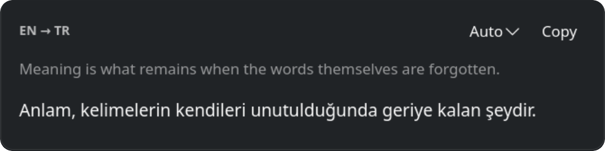

# mana

Translate selected text on Linux with one shortcut. Select text anywhere, press the shortcut, and the translation opens in a small popup.



"Mana" is Turkish for "meaning". The command is `mana`.

**Status:** in daily use on KDE Plasma 6 (Wayland). Other Wayland desktops are untested.

## Why

Translating a sentence should not mean copying it, switching to a browser tab and pasting it. mana is a small native tool for Wayland that does one thing: it reads the text you have selected, translates it, and shows the result where you are. There is no background service and no web view; the program starts when you press the shortcut and exits when the popup closes.

## Features

- Reads the text you highlighted with the mouse. No copy step is needed; if nothing is highlighted it uses the clipboard.
- Picks the direction for you: text in a foreign language is translated into your language, and text in your language is translated into a second language of your choice.
- Works with Google, the DeepL API, or DeepL without a key. If DeepL fails, the translation comes from Google and the popup says so.
- The popup can be dragged, remembers where you left it, and has a dropdown to translate into another language.
- `Esc` closes the popup, `Ctrl+C` or the Copy button copies the translation.
- Long translations scroll inside the popup.
- A command-line mode prints the translation without opening a window.

## Requirements

mana needs a Wayland compositor that supports the layer-shell protocol (KDE Plasma, Sway, Hyprland and other wlroots-based compositors). GNOME does not support it; there the popup opens as a normal window.

| | Needed for |
| --- | --- |
| Zig 0.17.x | building |
| GTK 4 | the popup |
| gtk4-layer-shell | placing the popup on screen |
| libwayland (with `wayland-scanner`) | reading the selection |
| pkg-config | finding the libraries at build time |
| wl-clipboard | copying the translation (`wl-copy`); also reading the selection on compositors without the `ext-data-control` protocol |

### Arch Linux

```sh
sudo pacman -S --needed zig gtk4 gtk4-layer-shell wayland pkgconf wl-clipboard
```

### Fedora

```sh
sudo dnf install gtk4-devel gtk4-layer-shell-devel wayland-devel pkgconf-pkg-config glibc-devel wl-clipboard
```

### Debian and Ubuntu

```sh
sudo apt install libgtk-4-dev libgtk4-layer-shell-dev libwayland-dev libwayland-bin pkgconf libc6-dev wl-clipboard
```

`libgtk4-layer-shell-dev` is available from Debian 13 and Ubuntu 26.04 on. Ubuntu 24.04 does not package it; there [gtk4-layer-shell](https://github.com/wmww/gtk4-layer-shell) has to be built from source first.

### Zig

Only Arch packages Zig 0.17 at the moment. On other distributions, download the 0.17.x archive for your platform from [ziglang.org/download](https://ziglang.org/download/), unpack it, and put its directory on your `PATH`:

```sh
tar -xf zig-x86_64-linux-0.17.1.tar.xz
export PATH="$PWD/zig-x86_64-linux-0.17.1:$PATH"
zig version    # 0.17.1
```

Zig is not yet stable between releases; other versions will most likely not build this code.

mana is developed and tested on an Arch-based system. The package lists for Fedora, Debian and Ubuntu were checked against the distributions' package indexes, but the build itself has not been tried there.

## Install

```sh
git clone https://github.com/semihgume/mana.git
cd mana
zig build -Doptimize=ReleaseSafe -p ~/.local
```

This puts the program at `~/.local/bin/mana`. Make sure `~/.local/bin` is on your `PATH`, then check that it works:

```sh
mana --print "Hello"
```

```
[en -> tr]
Merhaba
```

To update, pull the changes and run the same `zig build` command again. To remove mana, delete `~/.local/bin/mana`, `~/.config/mana` and `~/.local/state/mana`.

## Set up the shortcut

mana does not listen for keys itself; on Wayland that is the desktop's job. Bind a global shortcut to the `mana` command.

### KDE Plasma

Create a launcher entry so mana shows up in the shortcut settings:

```sh
mkdir -p ~/.local/share/applications
cat > ~/.local/share/applications/mana.desktop <<EOF
[Desktop Entry]
Type=Application
Name=mana
Comment=Translate the selected text
Exec=$HOME/.local/bin/mana
Icon=preferences-desktop-locale
Categories=Utility;
StartupNotify=false
EOF
```

Then open System Settings > Keyboard > Shortcuts, choose Add New > Application, pick mana, and assign a key such as `Meta+C`.

### Other desktops

Bind a key to the command in the compositor's configuration. For example, in Sway:

```
bindsym Mod4+c exec ~/.local/bin/mana
```

## Usage

### The popup

1. Select text with the mouse in any application.
2. Press your shortcut.
3. Read the translation. Press `Esc` or click elsewhere to close the popup.

The header shows the direction, for example `EN → TR`, and the service when it is not Google.

| Action | How |
| --- | --- |
| Close | `Esc`, or click outside the popup |
| Copy the translation | `Ctrl+C` with nothing selected, or the Copy button |
| Copy part of it | Select the part with the mouse, then `Ctrl+C` |
| Translate into another language | The dropdown in the header; "Auto" is the automatic direction |
| Move the popup | Drag it by the header or any empty area |

The popup opens where you last dropped it. To send it back to the top center of the screen, delete `~/.local/state/mana/position`.

If no text is selected and the clipboard holds no text, the popup says so instead of translating.

### The command line

```
mana [--print] [-t LANG] [TEXT...]
```

| | |
| --- | --- |
| `mana` | Translate the current selection in a popup |
| `mana "Good morning"` | Translate the given text in a popup |
| `mana --print "Good morning"` | Print the translation to the terminal, no popup |
| `mana -t de "Good morning"` | Translate into German regardless of the automatic direction |
| `mana --help` | Show the usage text |
| `mana --version` | Show the version (`-V` for short) |

`--print` writes the direction on the first line and the translation after it, and exits with status 1 when the translation fails.

## Configuration

Settings live in `~/.config/mana/config` (or `$XDG_CONFIG_HOME/mana/config`). The file is optional: without it mana uses Google and translates between Turkish and English.

```sh
mkdir -p ~/.config/mana
$EDITOR ~/.config/mana/config
```

The format is one `key = value` per line. Lines starting with `#` are comments. Changes apply the next time you press the shortcut.

```ini
# ~/.config/mana/config
backend = google
native = de
fallback = en
languages = de, en, fr, es, pt
```

| Key | Default | Meaning |
| --- | --- | --- |
| `backend` | `google` | Translation service: `google`, `deepl` or `deepl-web`. See [Translation services](#translation-services). |
| `native` | `tr` | Your language. Text in any other language is translated into it. |
| `fallback` | `en` | Text that already is in your `native` language is translated into this one. |
| `languages` | `tr, en, de, fr, es, it, ru, ar, ja, zh-CN` | The languages offered in the popup's dropdown, in this order, after "Auto". |
| `deepl_key` | none | Your DeepL API key. Required for `backend = deepl`. |

Languages are written as two-letter codes such as `en`, `de`, `fr`, `tr`; Chinese is `zh-CN` (simplified) or `zh-TW` (traditional). The dropdown shows a name for the common ones and the code itself for the rest.

A line mana cannot understand (an unknown key, a missing `=`, an unknown backend) is skipped and the default for that setting stays in place. The problem is shown as a dim `Config:` line at the bottom of the popup and printed on standard error with the file's path. To see all messages, run mana from a terminal:

```sh
mana --print "Hello"
```

### How the direction is chosen

With `native = de` and `fallback = en`:

- You select English, French or Japanese text: it is translated into German.
- You select German text: it is translated into English.
- You pick a language in the dropdown, or pass `-t`: that language is used, whatever the text is.

## Translation services

Whichever service you choose, the text you select is sent to it over the network. Do not use mana on text you would not paste into that service's website.

### Google (default)

```ini
backend = google
```

Needs no account and no key. It uses the keyless endpoint behind Google Translate's web clients. That endpoint is unofficial: it works today, but Google may limit or change it without notice.

### DeepL API

```ini
backend = deepl
deepl_key = 0123abcd-0000-0000-0000-000000000000:fx
```

Uses the official DeepL API with your own key. Create a key in your DeepL account under API keys; the free plan is enough. Keys that end in `:fx` belong to the free plan and are sent to the free endpoint automatically. Keep the key private with `chmod 600 ~/.config/mana/config`; mana warns when other users can read a config file that holds a key.

Notes:

- DeepL counts the characters you send against your plan's quota. When the selected text already is in your `native` language, mana sends it twice (once to detect that, once to translate into `fallback`), so it counts twice.
- If a DeepL request fails for any reason (no quota left, a wrong key, a language DeepL does not support, a network error), mana translates with Google instead and the popup header reads `Google (DeepL failed)`.
- If `backend = deepl` is set without a `deepl_key`, mana uses Google.

### DeepL without a key

```ini
backend = deepl-web
```

Uses DeepL without an account, through the endpoint that DeepL's own apps talk to. The header reads `DeepL web`.

> **Use at your own risk.** This endpoint is not a public API. It is not covered by DeepL's API terms, DeepL may rate-limit clients that use it (HTTP 429), and it may change or stop working at any time. If you rely on DeepL, use the official API with a key.

Limits and behavior:

- At most 1500 characters per translation. Longer text is not sent to DeepL at all; it is translated by Google and the header reads `Google (too long for DeepL)`.
- Any failure falls back to Google, as with the official API.

## Troubleshooting

Run mana from a terminal to see its messages: `mana --print "Hello"` for the translation path, or `mana "Hello"` for the popup.

| Symptom | Cause and fix |
| --- | --- |
| The popup says "No text selected." | Nothing is highlighted and the clipboard holds no text. Select the text again, or copy it, and press the shortcut. |
| The popup says "The selection is not text." | The clipboard holds an image or other data. |
| The popup opens as an ordinary window | The compositor does not support layer-shell (GNOME, for example). mana prints a warning and falls back to a normal window. |
| The header reads `Google (DeepL failed)` | The DeepL request failed; the terminal output shows the HTTP status. 403 means a wrong key, 456 means the quota is used up, 429 means too many requests. |
| "No network connection." or "The translation service did not answer in time." | The service could not be reached. The popup and `--print` give up after 15 seconds. |
| "The translation service got too many requests from this computer." | The service is rate-limiting your connection (Google does this after many requests in a short time). It usually clears by itself within hours. |
| My settings are ignored | If the file has problems, the popup shows the first one at the bottom (`Config: ...`, with `(+N more)` for the rest). Run `mana --print "Hello"` to see all of them with the file's path; if nothing is printed, check that the file is at the path given under [Configuration](#configuration). |
| The popup closes by itself | It closes when it loses keyboard focus, for example when another window takes focus. |
| The popup opens in an odd place | Delete `~/.local/state/mana/position`. |
| Copy does nothing, or the button says "Copy failed" | `wl-copy` is missing. Install wl-clipboard. |

## Development

```sh
zig build                              # debug build in zig-out/bin/
zig build test                         # unit tests
zig build run -- --print "Hello"       # run without installing
```

The source is in `src/`: `main.zig` (arguments and wiring), `selection.zig` (reads the selection over Wayland), `translator.zig` (the translation services), `config.zig` (the settings file), `state.zig` (the remembered position) and `ui.zig` (the GTK popup).

## License

[MIT](LICENSE)
